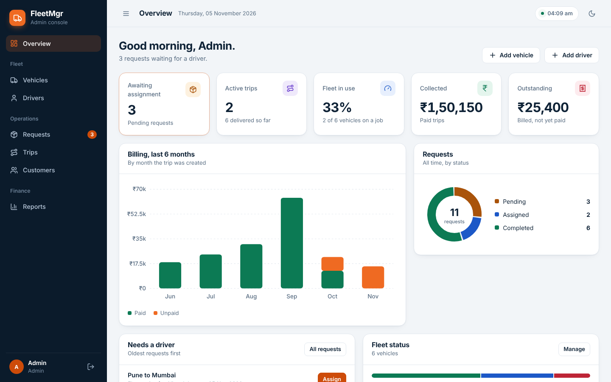
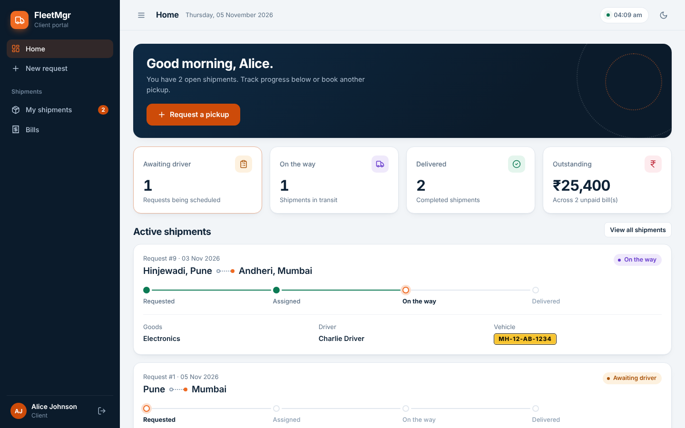
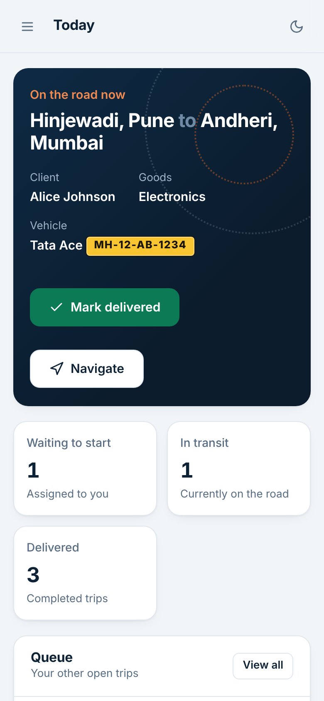
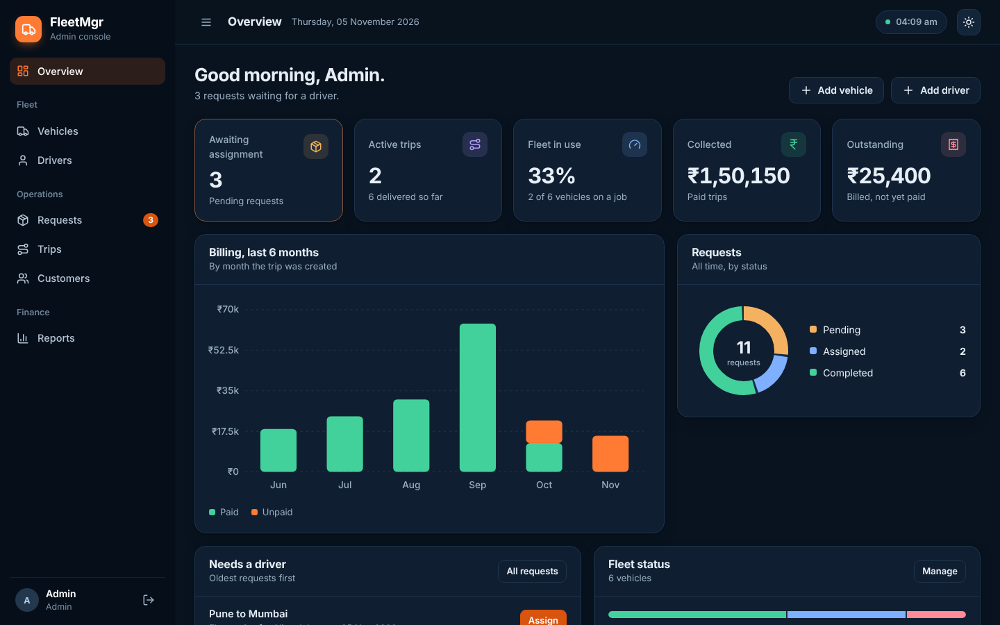

# FleetMgr — Fleet Management System

A web app for running a small trucking or logistics operation. Clients request pickups, dispatch assigns a driver and vehicle, drivers update trip progress from their phone, and admins price trips and track payments.

Built with **Flask**, **PostgreSQL** and plain HTML/CSS/JS (no frontend build step).



## Features

**Admin console**
- Overview with KPIs, a six-month billing chart, request breakdown and fleet status
- Vehicles and drivers: add, edit and delete, with live availability
- Assign a driver and vehicle to a request in one dialog
- Searchable, filterable tables for requests, trips and customers
- Reports: set trip prices, mark payments, export billing to CSV
- Light and dark themes

**Client portal**
- Request a pickup with a live route preview
- Shipment tracker: Requested → Assigned → On the way → Delivered
- Invoices you can print, with totals in Indian rupee formatting

**Driver portal** (built for phones)
- "Up next" trip with Start trip and Mark delivered buttons
- One-tap Navigate (Google Maps) and Call client

**Security**
- Passwords stored as salted PBKDF2 hashes
- CSRF protection on every form
- Role-based access; drivers can only update their own trips
- Secrets live in `.env`, not in code
- Trip assignment is transactional, so a vehicle can't be double-booked

| Client portal | Driver portal | Dark mode |
|---|---|---|
|  |  |  |

## Getting started

**Requirements:** Python 3.10+ and PostgreSQL 13+.

```bash
# 1. Install dependencies
python -m venv .venv
source .venv/bin/activate        # Windows: .venv\Scripts\activate
pip install -r requirements.txt

# 2. Create the database and load the schema + sample data
createdb -U postgres fleet_db
psql -U postgres -d fleet_db -f schema.sql

# 3. Configure
cp .env.example .env             # Windows: copy .env.example .env
# edit .env: set DB_PASSWORD and a SECRET_KEY

# 4. Run
python app.py
```

Open http://localhost:5000.

> `schema.sql` drops and recreates all tables, so only run it on a fresh database.

### Demo accounts

With `DEMO_MODE=true` the login page has one-click buttons for these:

| Role | Email | Password |
|---|---|---|
| Admin | admin@fleet.com | admin123 |
| Client | alice@example.com | user123 |
| Driver | charlie@fleet.com | driver123 |

Set `DEMO_MODE=false` and change these passwords before any real deployment.

## Project structure

```
app.py              Routes, database access, security
schema.sql          PostgreSQL schema and sample data
templates/          Jinja templates (one per portal, plus shared pieces)
static/css/app.css  Design system (colours, components, dark mode)
static/js/app.js    Tabs, dialogs, filters, charts, CSV export
```

## Roadmap ideas

- Email or SMS notifications when a trip status changes
- Live driver location on a map
- Online payments
- Per-trip distance and automatic price suggestions
